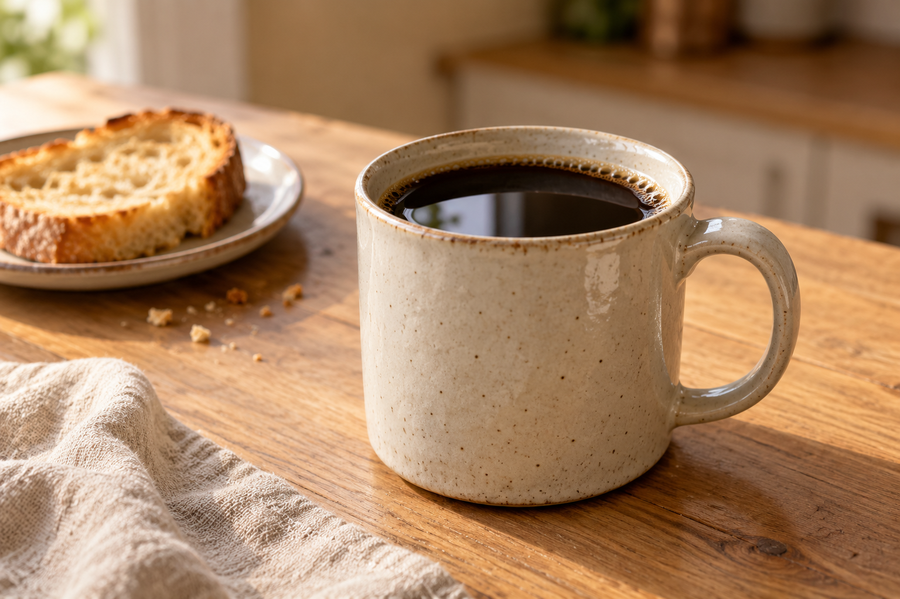

# ☕ Café Quase Real: Natural ou Fake Natty?

**Uma manhã que nunca aconteceu, criada com inteligência artificial.**

> **Imagem gerada por IA.** A cena e a caneca são fictícias. Este projeto foi preparado para o desafio **Natural ou Fake Natty?**, da DIO.

## 📒 Descrição

O **Café Quase Real** explora como uma IA generativa pode produzir uma imagem com aparência de fotografia editorial a partir de uma descrição textual.

O tema escolhido foi uma pausa para café: uma caneca de cerâmica, luz de janela, madeira, pão e tecido. São elementos cotidianos que permitem observar textura, profundidade, reflexos e pequenas imperfeições.

O projeto combina **uma imagem original gerada por IA**, **um texto criativo** e a documentação do processo. A proposta se aproxima da criação de conteúdo visual para e-commerce, usando um produto fictício para este experimento.

## 🤖 Tecnologias Utilizadas

| Ferramenta ou formato | Uso no projeto |
| --- | --- |
| ChatGPT | Desenvolvimento do conceito, redação do briefing, documentação e texto criativo |
| Geração de imagens integrada ao ChatGPT | Criação da cena a partir do prompt textual |
| Markdown | Organização do README e dos arquivos de documentação |
| PNG | Formato da imagem final, com resolução de 1536 × 1024 pixels |

O projeto pode ser visualizado diretamente pelos arquivos. Não exige instalação, código executável ou chave de API.

## 🧐 Processo de Criação

1. **Definição do conceito:** escolher uma cena cotidiana para explorar o limite entre uma fotografia e uma imagem sintética.
2. **Construção do prompt:** especificar objeto, ambiente, enquadramento, luz, materiais e elementos a evitar.
3. **Geração da imagem:** usar a ferramenta integrada de imagens com o prompt documentado em [PROMPTS.md](PROMPTS.md).
4. **Revisão visual:** observar a caneca, a alça, o contato com a bancada, a iluminação e as texturas. As observações estão em [ANALISE.md](ANALISE.md).
5. **Criação do texto:** desenvolver uma pequena narrativa inspirada na cena, disponível em [CONTEUDO.md](CONTEUDO.md).
6. **Organização da entrega:** reunir imagem, documentação e orientações de publicação.

A versão entregue utiliza **uma geração de imagem**, sem fotografia de referência e sem retoques posteriores. Termos como “lente de 50 mm” foram usados como orientação estética no prompt; não representam uma câmera utilizada.

## 🚀 Resultados

O resultado é uma cena sintética de café da manhã, acompanhada de um texto criativo e de um registro do processo.

### Uma manhã que nunca aconteceu

> A luz encontra a mesa antes de qualquer compromisso. Na madeira, uma caneca guarda o café; ao lado, o pão deixa pequenas migalhas no prato. O pano de linho ficou como foi pousado, sem pressa de parecer perfeito.
>
> Há manhãs em que o primeiro gesto é só esse: aproximar a cadeira, segurar a caneca e deixar o dia esperar mais um instante.
>
> Nada nesta cena foi fotografado. A mesa, a luz e o café nasceram de palavras. A familiaridade que a imagem desperta é o ponto de partida deste experimento: quanto do que parece real vem dos detalhes que aprendemos a reconhecer?

*Texto ficcional criado com auxílio de IA.*

A revisão visual identificou elementos que favorecem a aparência fotográfica, como reflexos na cerâmica e no café, sombra de contato e desfoque do fundo. Essa avaliação é qualitativa: não foi realizado teste cego com participantes nem calculada uma taxa de reconhecimento.

### Arquivos do projeto

| Arquivo | Conteúdo |
| --- | --- |
| [cafe-quase-real.png](cafe-quase-real.png) | Imagem gerada por IA |
| [PROMPTS.md](PROMPTS.md) | Prompt exato da imagem e orientação para o texto |
| [ANALISE.md](ANALISE.md) | Observações sobre realismo, limites e reprodução |
| [CONTEUDO.md](CONTEUDO.md) | Texto criativo, descrição do repositório, submissão DIO e post social |
| [COMO_PUBLICAR.md](COMO_PUBLICAR.md) | Passo a passo para publicar o projeto |

## 💭 Reflexão

O realismo da imagem depende da relação entre os detalhes. A luz precisa combinar com as sombras; a textura deve fazer sentido para cada material; os objetos precisam parecer apoiados no mesmo espaço.

A descrição de uma cena simples, com materiais e iluminação definidos, ajudou a orientar a geração. Ao mesmo tempo, o resultado não comprova propriedades físicas de um produto nem garante que uma nova geração reproduza a mesma caneca.

Para um uso comercial, a fidelidade ao produto real precisaria ser conferida. Neste experimento, o objeto é fictício e a origem sintética da imagem está identificada.

## 🔗 Desafio

Projeto preparado a partir do enunciado e do template do laboratório [Natural ou Fake Natty? — DIO](https://github.com/digitalinnovationone/lab-natty-or-not).

**#LabDIONattyOrNot**

